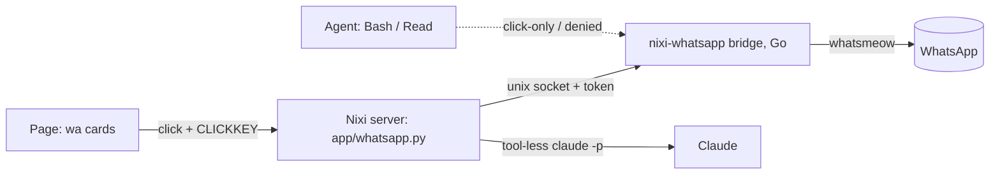

# Spec: WhatsApp in Nixi

The intent's approved answers carry over unchanged:

- **Ban risk:** accepted, with 2 linked-device slots free.
- **History:** only the bridge's store, removed with "Unlink and forget".
- **Groups:** read and download only. Group messages raise a card only
  when the owner is mentioned.
- **Voice notes:** shown as "voice message", downloadable, not played.
- **Summaries:** Claude, at most 50 messages or 8,000 characters of one
  direct chat, never saved to session history.
- **Same-user risk:** Flux-level protection is accepted.
- **Screen captures:** WhatsApp cards are hidden from agent captures.

## Design

### 1. The bridge: `whatsapp-bridge/` (Go)

**Source.** A fork of `lharries/whatsapp-mcp` at `7d6a06d`: the Go bridge
only, MIT. It keeps a `LICENSE` and a `NOTICE` naming the upstream.

- The single 1,200-line `main.go` is split into files: `main.go`,
  `api.go`, `store.go`, `send.go`, `read.go`, `pair.go` and `events.go`.
- Much of the HTTP and send path is rewritten anyway, so the spec allows
  the plan to write any file fresh where that is smaller. This is the
  "minimal bridge" option from the intent, applied file by file.
- whatsmeow moves to `v0.0.0-20261125185702-10b99a98616e`, applying the
  five API changes from upstream PR #402. Go and the other modules move to
  current versions.

**Flags.** `--state DIR` (default `$XDG_STATE_HOME/nixi-whatsapp`),
`--run DIR` (default `$XDG_RUNTIME_DIR/nixi-whatsapp`), and
`--max-file-mb 100`.

**Storage.**
- `DIR/whatsapp.db` (session) and `DIR/messages.db` (chats and messages).
- Both directories are 0700, files 0600, and the process sets
  `umask(077)`.
- `messages.db` gets indexes on `(chat_jid, timestamp)` and WAL mode.

**Startup.**
- The bridge writes a fresh 32-byte token to `RUN/token` (0600), then
  listens on `RUN/sock` (0600).
- If anything fails (store, socket or WhatsApp client), it exits non-zero.
- It never opens a TCP port.

**API.** HTTP over the Unix socket. Every request needs
`Authorization: Bearer <token>`; otherwise it gets 401. JSON in and out.

| Method and path | Does |
|---|---|
| `GET /status` | `{paired, connected, me, slots_note}` |
| `POST /pair` | Starts pairing, and returns the current QR code as a PNG data URL, refreshed by calling it again. It never logs the QR. |
| `POST /forget` | Logs out, closes, and deletes both databases and `RUN/dl`. The process then exits 0. |
| `GET /chats?q=&limit=` | Chats by last activity: `{jid, name, is_group, last_at, unread, last_preview}` |
| `GET /contacts?q=` | Name or number search over contacts and direct chats, exact JIDs only |
| `GET /thread?jid=&limit=&before=` | Messages: `{id, from_me, sender_name, at, text, kind, caption, file_name, size, edited, deleted}` |
| `GET /since?t=` | New incoming messages after `t`, for notifications: `{jid, id, at, is_group, mentions_me}`. No text. |
| `POST /send` | `{jid, text}` → `{result: "sent"|"not_sent"|"unknown", id?}`. Group JIDs (`@g.us`) are refused with `not_sent`. |
| `POST /send-file` | `{jid, staged, caption?}`. `staged` must match `^[A-Za-z0-9_-]{16,64}$`. The file is opened as `RUN/stage/<staged>` with `O_NOFOLLOW`, must be a regular file, and must be under the size limit. It is deleted after any attempt. |
| `POST /download` | `{jid, id}` → `{file: "<generated>.<ext>", name: "<sender's name, display only>"}`. The file goes to `RUN/dl/`. |

**What `send` results mean:**
- `not_sent`: the client was not connected, or the request failed checks,
  before `SendMessage` was called.
- `unknown`: `SendMessage` returned an error or timed out after it was
  called.
- `sent`: it returned an id.

**Downloads.**
- The file name is `<unix-ms>-<random>.<ext from mimetype>`. Upstream's
  download-URL handling is fixed as reported in upstream issue #382 (the
  query string is kept).

**Events.**
- Message: stored with `mentions_me` taken from `ContextInfo.MentionedJID`.
- Edit (`ProtocolMessage` `MESSAGE_EDIT`): the stored text is updated, and
  `edited` is set.
- Revoke: the text and media keys are cleared, and `deleted` is set.
- History sync: stored the same way.
- `LoggedOut`: `paired` becomes false, and `/status` reports it.

**Logging.** Only state changes and error kinds. Never message text,
names, JIDs, QR codes or paths.

**Tests (Go).**
- token and 401;
- socket mode 0600, and no TCP listener;
- `staged` name validation, symlink refused, size limit;
- download names never come from the sender;
- group send refused;
- the result mapping, through a fake client interface.

### 2. Nix

- **`nix/whatsapp-bridge.nix`:** `buildGoModule` with `src = ../whatsapp-bridge`,
  `vendorHash`, CGO on for go-sqlite3, and `doCheck` running the Go tests.
  `flake.nix` gets `packages.nixi-whatsapp-bridge` and adds `go` to the
  dev shell.
- **nixi-nixarchy `nix/hm-module.nix`:**
  - A new `services.nixi.companion.whatsapp.enable` (default false) and
    `whatsapp.package`.
  - It defines `systemd.user.services.nixi-whatsapp`: `ExecStart` is the
    bridge, with `StateDirectory=nixi-whatsapp`, `StateDirectoryMode=0700`,
    `RuntimeDirectory=nixi-whatsapp`, `RuntimeDirectoryMode=0700`,
    `UMask=0077`, `Restart=on-failure` and `NoNewPrivileges=yes`.
  - It has **no `WantedBy`**: Nixi starts and stops it.
  - It also sets `whatsapp_bridge = true` in the companion's managed config,
    so the setting only appears where the service exists.
- **nixos_config:** set `services.nixi.companion.whatsapp.enable` on p620
  first, then on razer after the gate in Verification. Bump
  `nixi-companion` and `nixi-nixarchy`. p510 is not touched.

### 3. Nixi server

**`app/whatsapp.py`** is a client modelled on `app/phone.py`:
- an `http.client` connection over the Unix socket, reading the token on
  each connect;
- `NotSent` and `Unknown` exceptions, and an allow-list of paths;
- `stage(bytes) -> name`, which writes `RUN/stage/<token_urlsafe(24)>` with
  `O_EXCL|O_NOFOLLOW` and mode 0600;
- `fetch(file) -> path`, which moves `RUN/dl/<file>` to
  `~/Downloads/WhatsApp/` (created 0700) with `O_EXCL`, adding `-1`, `-2`
  on a clash. It never overwrites.

**State in `app/server.py`,** next to the `PHONE_*` state:
- `WA_LOCK`, `WA_GEN` (bumped when WhatsApp is turned off, the bridge is
  lost, the screen locks or it is unlinked), `WA_DRAFT` (one-use tokens,
  600 s) and `WA_FILE` (staged name bound to `jid`, file name and size).
- The lock order is `WA_LOCK` alone. It is never held with `Call.lock` or
  `PHONE_LOCK`.

**Setting `whatsapp_on`.**
- It shows only when `whatsapp_bridge` is true.
- On: `systemctl --user start nixi-whatsapp`. Off: stop it, bump `WA_GEN`,
  delete `RUN/stage/*`, and drop WhatsApp cards.
- Nixi starts the service at login when the setting is on.
- **"Unlink and forget"** (click-only) calls `/forget`.

**Cards.** These stage kinds are added to `phone_on_screen`'s list
(`server.py:7814`) and the private list (`stages.py:430`):
- `wa_pair`: the QR code, refreshed every 20 s. It closes on lock or after
  3 minutes.
- `wa_chats`: a list, with a pick when there are several matches.
- `wa_thread`: up to 100 messages, with buttons: Reply, Send a file,
  Summarise, Suggest a reply. Group threads have only Summarise and
  Download.
- `wa_draft`: the recipient, an editable body, and Send.
- `wa_file`: the recipient, the file name, the size, an optional caption,
  and Send.
- `wa_summary`: the summary text, with "Use as reply" only after
  "Suggest".

**Sending.**
- `wa_send(draft_id, text, keyed)` and `wa_send_file(file_id, caption,
  keyed)` copy `phone_send` (`server.py:8040–8066`): `keyed` is required,
  the draft is consumed first, and the generation is checked.
- On `not_sent`, the draft or file is re-armed (the file only if it is
  still staged). On `unknown`, the card says "may have been sent: check
  your phone", nothing is re-armed, and there is no retry. On `sent`, the
  card shows done.

**Picking a file.**
- The `wa_file` card has a button that opens an `<input type=file>`.
  WebKitGTK shows the GTK file chooser, and `window.py` needs no change.
  Dropping a file on the card works too.
- The page `POST`s the bytes to `/api/wa/stage?draft=<id>`. The request
  needs the click key and a trusted event. It is refused over the size
  limit or when no `wa_file` draft is open.
- The server stages the bytes and binds them to that draft.

**Endpoints.**
- Click-only (CLICKKEY plus `isTrusted` pointer, as in the #121 call
  cards): `/api/wa/send`, `/api/wa/send-file`, `/api/wa/stage`,
  `/api/wa/download`, `/api/wa/forget`.
- Not click-only: `/api/wa/pair`, `/api/wa/thread` and `/api/wa/summary`.
  They only read or show.

**New messages (`wa_tick`, in the phone tick's worker).**
- It polls `/since` every 10 s while connected.
- A direct message, or a group message that mentions the owner, queues a
  "New WhatsApp message: open?" card. With `notify_details` on, it names
  the sender. It uses the phone's quiet check (`server.py:8083–8084`).
- WhatsApp Web notifications still count as chat (`server.py:3523`). When
  the bridge is connected, the WhatsApp Web row in the notification feed is
  not turned into a card, so a message is not announced twice.

**Phrases (`app/quick.py`), in en, nb and pl:**
- `wa_read` ("read my WhatsApp", "WhatsApp messages");
- `wa_open` ("WhatsApp <name>");
- `wa_reply` ("reply to <name> on WhatsApp [saying …]");
- `wa_file` ("send a file to <name> on WhatsApp");
- `wa_summary` ("summarise my WhatsApp with <name>").

Every phrase containing the word WhatsApp (in each language) is handled
locally. When WhatsApp is off, unpaired or ambiguous, it answers with a
card and **never falls through to Claude**.

**Speech.** WhatsApp names and text are never spoken. Each card speaks a
fixed line, such as "Here are your WhatsApp chats."

### 4. Summary and suggested reply

`wa_summarise(jid, mode)` runs only from a click or phrase on an open
direct chat:

- It builds the prompt from at most 50 messages or 8,000 characters, the
  newest first and trimmed. Each message is reduced to "me" or "them" and
  its text. Names are replaced with "Contact".
- The text sits inside `<untrusted_chat>` tags, with an instruction to
  treat it as data.
- It runs `claude -p --model haiku --tools "" --no-session-persistence
  --strict-mcp-config --disable-slash-commands`, with a 30 s timeout and
  `cwd` an empty temporary directory. The binary is found with
  `shutil.which("claude")`.
- **This runs even in Nixi mode.** That is a stated exception to "only
  through the bridge" (`docs/GUIDE.md:10`). The call has no tools and no
  session, so it is not an agent turn. The guide gets a line saying so.
- If `claude` is missing, the card says that summaries need the Claude CLI.
- The output is limited to 1,500 characters and shown as plain text.
  "Suggest" puts it into a new `wa_draft` that the owner edits. Nothing is
  sent.

### 5. Keeping the agent away from WhatsApp

**Bash.**
- A new `_WA_RE` in `app/server.py` matches commands that mention
  `nixi-whatsapp`, `whatsapp.db`, `messages.db` or the run and state
  paths. `click_only` ORs it in (`server.py:1008–1012`).
- nixi-nixarchy gets the twin `isWhatsapp` in `bridge/send-policy.js`,
  ORed into `isClickOnly`, with tests next to the `isFlux` tests.

**Read, Grep and Glob.**
- `app/server.py` adds `Read|Grep|Glob` to the PreToolUse matcher
  (`:6730`). `approve.py` denies those tools under the WhatsApp state,
  run and download paths.
- nixi-nixarchy gets the same deny in its permission path.
- This closes the Read leak that exists today.

**Screen captures.** `capture()` (`server.py:1481`) sends a `shot` event
first. While a `wa_*` card is on screen, the page hides it until a `shot`
end event, at most 3 s. Then it captures.

**What remains, and was accepted.** A script the agent writes, under a
name the rules don't match, can still reach the socket.

## Alternatives rejected

- **Upstream as is,** or its Python MCP server: the intent's findings
  (open API, any file can be sent, the lethal trifecta).
- **The wallaboohi fork:** its send path is still unconfined, and it is
  someone else's code. The owner chose our own fork.
- **mautrix-whatsapp on p510:** p510 needs the owner's OK for every change,
  and the chats would sit next to the agent bus.
- **The bridge as its own system user:** the owner accepted Flux-level
  protection, so the extra helper is not needed.
- **The summary through the nixi bridge (ACP):** the harnesses cannot run
  with no tools, and the call would land in the agent's session. A direct,
  tool-less `claude -p` is smaller and safer.
- **The bridge writing into `~/Downloads`:** the service would need write
  access to the home folder. Nixi moves the file out of `RUN/dl` instead.
- **A native GTK file chooser in `window.py`:** WebKitGTK already shows it
  for `<input type=file>`.

## Risks

- **An account ban** (accepted). The bridge never sends unless the owner
  clicks, which keeps traffic human-like.
- **WhatsApp changes its protocol.** Then pairing or sending fails until
  whatsmeow is updated. The card says "WhatsApp needs an update"
  (HTTP 405, or "client outdated", from the bridge status). The fix is a
  version bump, a `vendorHash` update and a deploy.
- **The two archives differ.** Each host keeps its own store.
- **Same-user leftover** (accepted). The guards are pattern-based.
- **Chat text reaches Anthropic** when the owner asks. It is capped and
  carries no names.
- **More work for the server.** The 10 s polling is local, and stops while
  the bridge is down.
- **Hosts.** p620 and razer get a new user service that does not start by
  itself, so a broken build only fails when the setting is turned on.
- **Cross-repo work.** nixi-nixarchy is involved (the module, the send
  policy and the read deny). The deploy needs both bumps in one
  nixos_config PR.

## Verification

- **Go:** `go test ./...` in `whatsapp-bridge/` (the cases above), and
  `nix build .#nixi-whatsapp-bridge`.
- **Python:**
  - new `tests/test_whatsapp.py`: the client against a fake socket
    server, the draft, send and file flows, `unknown` with no re-arm,
    `WA_GEN`, the stage binding, download without overwriting, and no
    fall-through to Claude;
  - `test_lang.py` and `test_lang_words.py` (en, nb, pl);
  - a `_WA_RE` and read-deny case in the approval tests.
- **Browser:**
  - `stages_fit.mjs` fixtures for the six `wa_*` cards, with made-up
    names;
  - an untrusted click and Enter/Space do not post;
  - the `shot` event hides a `wa_*` card.
- **nixi-nixarchy:** `send-policy` tests for `isWhatsapp`, and a module
  evaluation test for the new option.
- **Full suite:** the `nixoarchy-snowflake` suite and `nix flake check`.
- **Live, with the owner present, on p620 first:**
  1. pair with the QR code;
  2. read a chat;
  3. send a text to the owner's own number or a willing contact;
  4. send a small file;
  5. download a received file;
  6. turn off, then on;
  7. unlink and forget.

  razer is enabled only after steps 1–5 pass.
